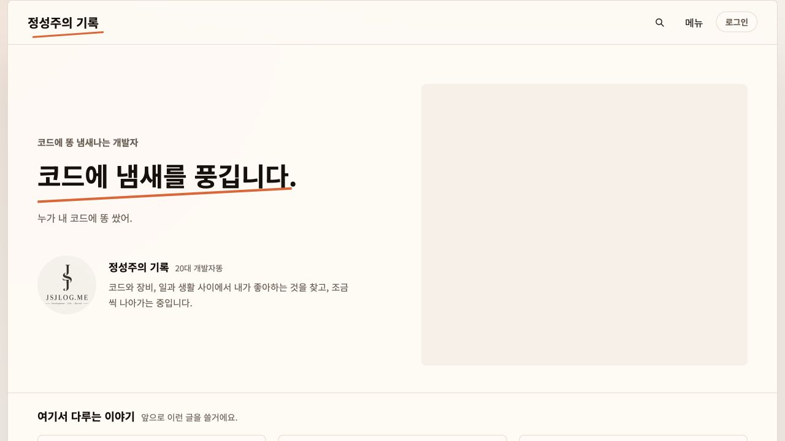
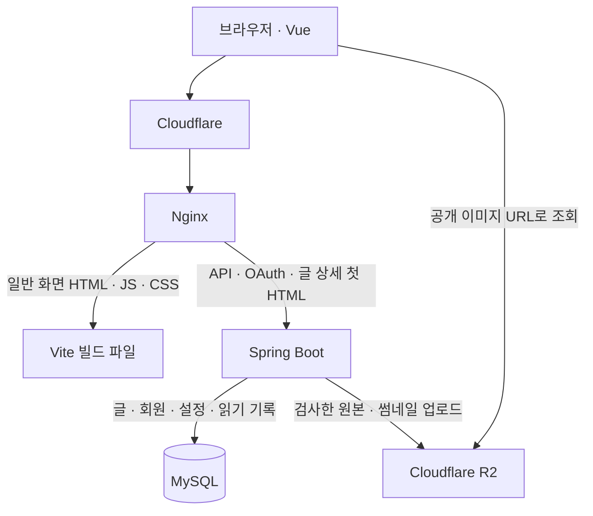
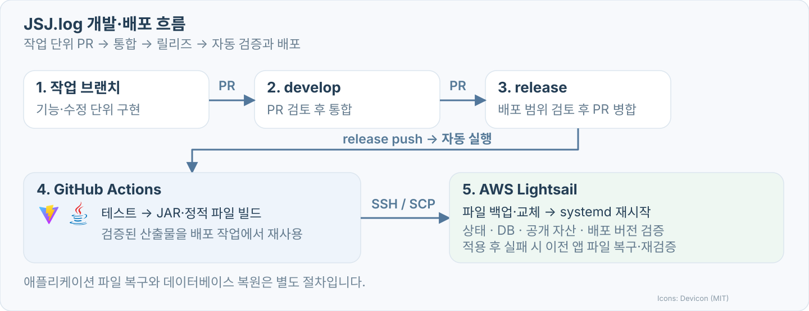

# JSJ.log
글을 쓰고, 댓글과 방명록으로 이야기를 나누고, 홈 화면까지 직접 관리하는 개인 블로그입니다.<br/>

[](https://jsjlog.me)

*2026년 10월 4일에 촬영한 홈 화면입니다. 아래 기능과 실행 방법은 현재 저장소의 소스를 기준으로 정리했습니다.*

[블로그 방문](https://jsjlog.me) · [주요 기능](#주요-기능) · [시스템 구조](#시스템-구조) · [로컬에서 실행하기](#로컬에서-실행하기) · [테스트와 빌드](#테스트와-빌드)

## 주요 기능

### 글, 댓글
카테고리별로 글을 둘러보거나 검색할 수 있습니다. 
글을 읽은 뒤에는 관련 글이나 이전·다음 글로 이어서 이동할 수 있습니다.

Google, Kakao, Naver 계정으로 로그인하면 댓글과 답글을 쓰고, 글이나 댓글에 반응을 남길 수 있습니다.<br/>
작성한 댓글을 모아 보거나 수정·삭제할 수 있고, 신고와 알림 기능도 제공합니다.<br/>
지운 댓글은 공개 화면에서 내리고, 신고 처리를 위해 마지막 내용과 변경 기록은 관리자만 볼 수 있게 보관합니다.<br/>
마지막 내용은 댓글 삭제일과 원글 영구 삭제일 중 더 이른 날부터 6개월이 지나면 정리합니다.<br/>
변경 기록은 기록된 날부터 6개월이 지나면 지우며, 원문을 파기할 때 남은 기록도 함께 정리합니다.<br/>
관련 구현은 [CommentRetention](backend/src/main/java/me/jsjlog/blog/post/service/CommentRetention.java)에 있습니다.<br/>
회원은 닉네임을 바꾸거나 탈퇴할 수 있습니다.

### 방명록
로그인한 회원은 방명록을 쓰고, 자신의 글을 고치거나 지울 수 있습니다.<br/>
비밀글을 남기거나 다른 글을 신고할 수도 있습니다. 관리자는 답글을 쓰고, 신고를 처리하거나 글을 가립니다.<br/>
작성자가 지운 글과 관리자가 가린 글은 구분해서 처리합니다.

작성자가 지운 방명록 원문·답글·신고 당시 사본은 6개월 뒤 정리합니다.<br/>
관리자가 가리기만 한 글에는 같은 삭제 기한을 적용하지 않습니다.<br/>
공개 범위와 보관 처리는 [방명록 기능](backend/src/main/java/me/jsjlog/blog/guestbook/)에서 확인할 수 있습니다.

### 읽은 글과 읽던 위치
회원은 최근 읽은 글과 읽던 위치를 다시 확인할 수 있습니다.<br/>
관리자 화면에서는 조회 기록과 활성 읽기 시간 통계도 확인합니다.

활성 읽기 시간은 **글 화면이 보이고 포커스가 있으며, 마지막 입력 후 60초 이내인 구간을 합산한 추정값**입니다.<br/>
실제로 글을 이해하거나 끝까지 읽었다는 뜻은 아닙니다. 관리자와 봇으로 분류된 조회는 측정 대상에서 제외합니다.<br/>
측정 조건은 [브라우저의 시간 계산](frontend/src/features/post/composables/activeTimeClock.js), [전송 처리](frontend/src/features/post/composables/usePostActiveTime.js), [서버 검증](backend/src/main/java/me/jsjlog/blog/post/service/PostActiveTimeHistory.java)으로 나눠 두었습니다.

### 글을 쓰고 관리하기
관리자는 블록 편집기로 글을 작성하고 발행합니다.<br/> 
작성 중인 내용은 브라우저에 임시 저장합니다. 글 수정 이력은 따로 남기지 않습니다.<br/> 
발행을 취소하거나 글을 휴지통으로 옮길 수 있고, 휴지통에 있는 글은 복원할 수 있습니다.<br/>
관리자 화면에서는 글뿐 아니라 카테고리와 메뉴, 댓글과 방명록, 회원, 업로드한 이미지도 관리합니다.

### 홈 화면의 내용도 관리자 화면에서
홈 화면의 문구를 고치거나 프로필 사진, 블로그 소개 등 대문에 들어가는 요소들을 변경할 때도<br/> 
관리자 화면을 사용하여 편집할 수 있도록 구성하였습니다. 

**관리자 화면에서 수정한 내용은 DB에 저장하고, 홈 화면에서 API로 다시 불러올 때 반영합니다.**<br/> 
문구나 이미지를 바꿀 때 프론트엔드를 다시 배포할 필요가 없습니다.<br/>
화면 배치와 스타일, 버튼 이름처럼 고정된 문구는 코드에서 수정합니다.

홈의 상단 소개·주제 소개·주제 목록·인기글·최근 글은 각각 불러오며, 먼저 응답한 영역부터 표시합니다.<br/>
조회에 실패하면 해당 영역만 다시 시도할 수 있습니다. 홈으로 돌아왔을 때 이전에 받은 결과가 있으면 먼저 보여 주고, 갱신에 실패해도 이미 보이던 내용은 유지합니다.<br/>
인기글과 최근 글은 조회에 성공했지만 글이 없으면 빈 상태를 표시합니다. 주제 조회가 모두 끝나고 오류와 표시할 주제가 없으면 주제 영역을 숨깁니다.<br/>
홈과 헤더는 같은 프로필 정보를 사용합니다. 프로필 갱신에 실패하면 이전에 받은 결과를 유지합니다.

## 시스템 구조
다음은 저장소의 애플리케이션과 Nginx 설정 예제, 배포 스크립트가 전제하는 구조입니다.<br/>
운영 서버에 어떤 설정과 버전이 실제 적용되었는지는 배포 후 별도로 확인합니다.



[SVG 구조도](assets/readme/architecture.svg)에서도 구성 요소의 연결을 볼 수 있습니다.

일반 화면에 접속하면 Nginx가 HTML, CSS, JavaScript 파일을 보내줍니다.<br/>
이 파일은 Vite로 빌드한 결과물이며, Vue 앱은 방문자의 브라우저에서 실행됩니다.

글 목록이나 본문이 필요하면 Vue에서 API를 호출합니다.<br/>
요청은 Cloudflare와 Nginx를 거쳐 Spring Boot로 전달됩니다.<br/> 
백엔드는 요청에 필요한 권한과 입력값을 확인한 뒤 MySQL에서 데이터를 읽거나 수정합니다.<br/> 
Vue는 그 응답을 받아 화면에 보여줍니다.

글 상세 주소 `/posts/{id}`의 첫 HTML은 별도 경로를 사용합니다.<br/>
Nginx가 Spring Boot로 전달하고, 백엔드가 글 제목과 공유용 메타 정보를 넣어 응답합니다.<br/>
공개하지 않는 글이나 없는 주소에는 `404`를 반환합니다. Vue가 본문을 API로 읽어 화면을 그리는 흐름과 구분됩니다.<br/>
관련 코드는 [PostPageController](backend/src/main/java/me/jsjlog/blog/post/controller/PostPageController.java), [글 상세 프록시](ops/nginx/blog-page-meta.conf), [일반 화면 경로](scripts/nginx/blog-spa-routes.conf)에 있습니다.

이미지는 관리자가 이미지를 올리면 백엔드에서 파일을 검사하고 썸네일을 만든 뒤 R2에 저장합니다.<br/>
이후 브라우저는 이미지의 공개 URL로 직접 요청합니다.<br/>
즉 이미지와 관련된 메타데이터는 데이터베이스에, 사진 파일은 R2에 썸네일과 원본을 구분하여 저장합니다.

로그인은 Spring Security와 서버 세션을 사용합니다.<br/>
회원은 소셜 계정으로, 관리자는 아이디와 비밀번호로 로그인합니다.<br/> 
상태를 바꾸는 요청에는 CSRF 토큰도 함께 보냅니다.<br/>
API의 최종 인증과 인가는 서버에서 검사합니다. 프론트 라우터의 관리자 가드는 화면 이동을 돕는 장치입니다.

계정이나 글이 바뀐 뒤 도착한 글·댓글 반응, 댓글 수정·삭제의 이전 응답은 현재 화면에 적용하지 않도록 구분합니다.<br/>
이 화면 보호가 이미 서버로 보낸 요청의 처리를 취소한다는 뜻은 아닙니다.

### 사용한 기술

| 구분 | 기술과 버전 |
| --- | --- |
| 프론트엔드 | Vue 3.5 · Vue Router 4.6 · Vite 8.1 |
| 백엔드 | Java 21 · Spring Boot 4.1.2 · Gradle Wrapper 9.9.1 |
| 인증과 DB 접근 | Spring Security · Spring Data JPA · Querydsl 5.1 |
| 데이터베이스 | MySQL |
| 서버·배포 구성 | Nginx · AWS Lightsail · systemd |
| 프록시와 이미지 저장소 | Cloudflare · Cloudflare R2 |
| 테스트와 배포 | JUnit · Spring Boot Test · H2 · Node Test Runner · Playwright 1.63 · ESLint · GitHub Actions |
| CI 실행 환경 | Node.js 22 · Java 21 · MySQL 8.0.46 · Nginx 1.24 검사 컨테이너 |

라이브러리의 정확한 버전은 [package-lock.json](frontend/package-lock.json), [build.gradle](backend/build.gradle), [Gradle Wrapper 설정](backend/gradle/wrapper/gradle-wrapper.properties)에서 확인할 수 있습니다.<br/> 
CI에서 쓰는 버전은 [워크플로우 설정](.github/workflows/checks.yml), Nginx 검사 이미지는 [경로 검사 스크립트](scripts/test-nginx-routing.py)에 있습니다.

운영 서버의 과거 확인 내용은 [2026년 10월 4일 기록](ops/runtime-2026-10-04.md)에 정리했습니다.<br/>
이 기록이나 CI의 버전을 현재 운영 환경의 확인 결과로 사용하지 않습니다.

## 코드 살펴보기

프론트엔드는 `app`, `features`, `shared`로 나눴습니다.<br/>
`app`에는 앱의 시작점과 라우터를, `features`에는 글·회원·관리자 등 기능별 화면과 API 호출 코드를 둡니다.<br/> 
여러 기능에서 함께 쓰는 코드는 `shared`에 모았습니다.<br/>
공개 화면과 관리자 화면은 서로 다른 레이아웃을 쓰고, 각 페이지는 해당 경로에 접근할 때 불러옵니다.

백엔드도 글, 회원, 홈 설정처럼 기능별로 패키지를 나눴습니다.<br/>
각 패키지 안에서 Controller가 요청을 받고, Service가 처리한 뒤, Repository를 통해 데이터를 읽고 씁니다.<br/> 
DB에 저장할 데이터는 엔티티로, API로 주고받을 데이터는 DTO로 구분합니다.

```text
blog/
├── frontend/
│   ├── src/
│   │   ├── app/                 # 앱 진입점, 라우터, 페이지 메타 정보
│   │   ├── features/            # 공개 블로그·회원·관리자 기능
│   │   └── shared/              # 공통 API, UI, 콘텐츠 처리
│   └── tests/                  # 단위·브라우저·실제 API 통합 검사
├── backend/
│   └── src/
│       ├── main/java/me/jsjlog/blog/
│       │   ├── admin/          # 관리자 API·콘텐츠 운영
│       │   ├── home/           # 대문·프로필·주제 콘텐츠 설정
│       │   ├── post/           # 글·댓글·반응·읽기 기록
│       │   ├── guestbook/      # 방명록·비밀글·신고·보관 정리
│       │   ├── member/         # 회원·계정 상태
│       │   ├── history/        # 댓글 변경 기록 (글 기록은 남기지 않음)
│       │   ├── notification/   # 회원 알림
│       │   └── common/         # 인증·예외·응답·업로드 등 공통 기능
│       ├── main/resources/     # 프로필별 애플리케이션 설정
│       └── test/               # H2·격리 MySQL·실제 HTTP 통합 검사
├── .github/workflows/          # PR 검사·release 배포
├── scripts/                    # 배포·복구·배포 검증 스크립트
├── examples/                   # 로컬 실행 환경변수·소셜 로그인 설정 예제
├── ops/                        # 로컬 개발·운영·데이터베이스 절차
└── assets/readme/              # 공개 화면·구조도·로고 라이선스
```

| 찾고 싶은 내용 | 관련 코드 |
| --- | --- |
| 화면과 URL 연결 | [프론트 라우터](frontend/src/app/router/index.js) |
| 기능별 화면·상태·API | [프론트 기능 모듈](frontend/src/features/) |
| 공통 API 호출·CSRF·인증 만료 처리 | [API 클라이언트](frontend/src/shared/api/blogApiClient.js) |
| 공개 글 조회 API | [PostController](backend/src/main/java/me/jsjlog/blog/post/controller/PostController.java) |
| 방명록 화면과 API | [프론트 기능](frontend/src/features/guestbook/) · [백엔드 기능](backend/src/main/java/me/jsjlog/blog/guestbook/) |
| 내 읽기 기록과 위치 | [MemberReadingController](backend/src/main/java/me/jsjlog/blog/post/controller/MemberReadingController.java) |
| 조회 기록·활성 읽기 시간 | [PostViewService](backend/src/main/java/me/jsjlog/blog/post/service/PostViewService.java) · [관리자 조회 API](backend/src/main/java/me/jsjlog/blog/admin/controller/AdminPostViewController.java) |
| 관리자 글 API | [AdminPostController](backend/src/main/java/me/jsjlog/blog/admin/controller/AdminPostController.java) |
| 홈 콘텐츠 관리 | [관리자 홈 설정](frontend/src/features/admin/pages/AdminHomeSettingsPage.vue) · [홈 API·도메인](backend/src/main/java/me/jsjlog/blog/home/) |
| 홈 영역별 조회·실패 복구 | [홈 화면](frontend/src/features/home/pages/HomePage.vue) · [상단 소개](frontend/src/features/home/components/HomeHero.vue) · [주제 소개·목록](frontend/src/features/home/components/HomeTopicSection.vue) · [게시글 영역](frontend/src/features/home/components/PostSection.vue) · [영역별 로더](frontend/src/shared/composables/useSectionLoader.js) |
| 계정·글 변경 뒤 이전 응답 보호 | [글 반응](frontend/src/features/post/components/PostArticle.vue) · [댓글 반응·신고](frontend/src/features/post/composables/useCommentFeedback.js) · [댓글 수정·삭제](frontend/src/features/post/composables/useCommentManagement.js) |
| 인증·권한 정책 | [SecurityConfig](backend/src/main/java/me/jsjlog/blog/common/config/SecurityConfig.java) |
| 이미지 저장소 설정 | [UploadConfig](backend/src/main/java/me/jsjlog/blog/common/config/UploadConfig.java) |

## 로컬에서 실행하기

아래 안내는 JDK 21, Node.js 22.13.0 이상의 22.x, MySQL 8.0을 기준으로 합니다.<br/>
Node.js는 잠긴 Vite·ESLint 버전이 요구하는 최소 패치 버전도 맞춰 주세요.<br/>
이미지 저장소는 로컬에서도 R2를 사용하므로 본인의 개발용 Cloudflare R2 계정과 버킷도 준비해야 합니다.
R2 필수 설정이 비어 있으면 백엔드가 기동하지 않습니다.

처음 실행한다면 [로컬 개발 환경 준비](ops/local-development.md)부터 따라 해 주세요.<br/> 
DB와 계정을 만드는 방법, R2 키를 발급받는 방법을 순서대로 정리했습니다.<br/>
아래 명령은 DB와 R2를 준비한 뒤 실행합니다.

### 1. 환경변수 준비

저장소 루트에서 예제 파일을 복사합니다.<br/> 
`cp -n`을 사용하므로 기존 `.env` 파일이 있으면 그대로 둡니다.

```bash
cp -n examples/backend.env.example backend/.env
chmod 600 backend/.env
```

`backend/.env`를 열어 DB 비밀번호와 R2 값을 채웁니다.<br/>
[예제 파일](examples/backend.env.example)에서 사용하는 로컬 DB 이름은 `blog_local`입니다.

### 2. 백엔드 실행

앱이 `.env`를 자동으로 읽지는 않습니다.<br/> 
같은 터미널에서 환경변수를 먼저 불러오고 백엔드를 실행합니다.

```bash
cd backend
set -a
source .env
set +a
./gradlew bootRun
```

### 3. 프론트엔드 실행

새 터미널을 열고 저장소 루트에서 실행합니다.

```bash
cd frontend
npm ci
npm run dev
```

브라우저에서 [http://localhost:5173](http://localhost:5173)을 엽니다. 
API와 로그인 요청은 [Vite 프록시](frontend/vite.config.js)를 통해 로컬 백엔드로 전달됩니다.

### 4. 실행 결과 확인

별도 터미널에서 다음 두 요청을 보내봅니다.

```bash
curl --fail http://127.0.0.1:8080/api/health
curl --fail 'http://127.0.0.1:8080/api/v1/blog/posts?size=1'
```

첫 번째 요청은 서버가 응답하는지 확인합니다.<br/> 
두 번째 요청은 DB에서 글 목록을 읽어옵니다.<br/> 
새로 만든 DB에는 글이 없으므로 빈 목록이 나와도 정상입니다.

관리자 계정은 자동으로 만들어지지 않습니다.<br/> 
관리자 화면을 사용하려면 [로컬 개발 가이드](ops/local-development.md)에 따라 계정을 준비해 주세요.<br/> 
같은 문서에 이미지 업로드 확인 방법과 Google 로그인 설정도 있습니다.<br/> 
소셜 로그인은 선택 설정입니다. 로컬 예제는 Google만 등록하며, Kakao·Naver에는 별도 등록과 개발용 키가 필요합니다.

## 테스트와 빌드
아래 명령은 각각 저장소 루트에서 시작합니다.

### 백엔드
테스트를 실행하고 배포에 사용할 JAR 파일을 만듭니다.

```bash
cd backend
./gradlew --no-daemon clean test bootJar
```

기본 설정에서는 H2를 사용하고 실제 HTTP 관리자 브라우저 검사는 제외합니다.<br/>
격리 MySQL 검사 환경변수와 예전 선택 DB 검사 변수(`TRASH_TEST_DB_*`)를 설정하지 않은 일반 테스트 환경에서 실행합니다.<br/>
일부 테스트는 이미지 저장소를 테스트용 구현으로 대신합니다.<br/>
통과하더라도 실제 MySQL 연결이나 R2 업로드, 소셜 로그인 확인을 대신하지 않습니다.

### 프론트엔드

단위 테스트와 브라우저 테스트를 실행한 뒤 화면을 빌드합니다.

```bash
cd frontend
npm ci
npx playwright install chromium
npm run lint
npm test
npm run test:browser
npm run build
```

`test:browser`는 Vite를 직접 띄우고 준비한 API 응답이나 테스트 화면으로 브라우저 동작을 검사합니다.<br/>
백엔드를 먼저 실행할 필요는 없습니다. 아래의 실제 HTTP 통합 검사와는 다른 명령입니다.<br/>
Linux에서 브라우저 실행에 필요한 시스템 패키지가 없다면 `npx playwright install --with-deps chromium`으로 설치합니다.

### 격리 MySQL과 실제 HTTP 통합 검사

로컬에 **테스트 전용 MySQL 8.0 인스턴스**를 준비하고 다음 환경변수를 설정합니다.<br/>
운영 DB나 일반 개발 DB를 지정하지 않습니다.

| 환경변수 | 용도 |
| --- | --- |
| `BLOG_TEST_MYSQL_PORT` | 루프백의 테스트 전용 MySQL 포트. 1024~65535 범위 |
| `BLOG_TEST_MYSQL_USERNAME` | 테스트 스키마를 생성하고 정리할 수 있는 전용 인스턴스의 계정 |
| `BLOG_TEST_MYSQL_PASSWORD` | 해당 테스트 계정의 비밀번호. 셸 환경에서만 전달 |

```bash
cd backend
./gradlew --no-daemon mysqlTest
./gradlew --no-daemon browserIntegrationTest
```

`mysqlTest`는 지정한 핵심 트랜잭션·동시성·재시작 경로를 실제 MySQL에서 검사합니다.<br/>
`browserIntegrationTest`는 실제 Spring 서버와 MySQL을 띄우고 브라우저로 관리자 로그인, CSRF 거절, 글 저장·재조회·수정·발행·공개 조회를 확인합니다.<br/>
두 번째 명령에도 앞 절의 프론트엔드 의존성과 Chromium 설치가 필요합니다.

두 Gradle 작업은 필수 MySQL 환경변수가 없으면 실패하며 H2로 대체하지 않습니다.<br/>
검사는 루프백 연결과 `blog_ci_test_*` 스키마를 사용합니다. 같은 인스턴스를 여러 검사에서 동시에 공유하지 않습니다.<br/>
설정과 대상은 [build.gradle](backend/build.gradle), [MySqlTestDatabase](backend/src/test/java/me/jsjlog/blog/support/MySqlTestDatabase.java), [실제 HTTP 검사](backend/src/test/java/me/jsjlog/blog/support/AdminPostBrowserIntegrationTest.java)에서 확인할 수 있습니다.

### 배포·복구와 Nginx 경로 검사

```bash
python3 -m unittest discover -s scripts/tests -p '*_test.py'
python3 scripts/test-nginx-routing.py
```

첫 명령은 서버 없이 배포·복구 스크립트를 검사합니다.<br/>
두 번째 명령에는 프론트엔드 빌드 결과와 실행 중인 Docker가 필요합니다. Nginx 컨테이너에서 경로·404·HTML 캐시·보안 헤더를 검사하며, 백엔드는 테스트 응답으로 대신합니다.<br/>
실제 운영 Nginx의 설정을 검사하는 명령은 아닙니다.

빌드가 끝나면 백엔드 JAR는 `backend/build/libs/`에, 프론트엔드 파일은 `frontend/dist/`에 생성됩니다.<br/> 
GitHub Actions에서 실행하는 검사도 [Checks 워크플로우](.github/workflows/checks.yml)에서 확인할 수 있습니다.<br/>
`develop`·`release` 대상 PR과 `develop`, `feature/**`, `fix/**`, `hotfix/**` 푸시가 검사 대상입니다. 문서 브랜치의 푸시만으로는 이 워크플로우가 실행되지 않습니다.

## 개발하고 배포하기



작업 브랜치, `develop`, `release`를 구분해 변경을 검토합니다.<br/>
이 브랜치 구분만으로 별도의 개발 서버가 존재한다는 뜻은 아닙니다.

기능이나 수정 사항별 작업 브랜치에서 시작합니다.<br/>
구현과 테스트를 마치면 `develop`으로 PR을 열어 검토하고 병합합니다.<br/>
배포할 변경은 `develop`에서 `release`로 PR을 열어 다시 확인합니다.<br/>


`release`에 푸시되면 [Deploy Blog 워크플로우](.github/workflows/deploy.yml)가 Checks를 호출합니다.<br/>
이 검사에서 실패하면 애플리케이션 파일을 교체하는 단계로 진행하지 않습니다.<br/>
검사를 통과해 보관한 동일한 JAR와 프론트엔드 빌드 파일을 Lightsail에 배포하고, systemd로 백엔드를 다시 시작합니다.<br/>
Nginx는 배포된 프론트엔드 파일을 제공합니다.

배포 검사는 상태 API뿐 아니라 DB 기반 조회, 공개 글 메타 정보, 404, 앱 파일, HTML 캐시 정책과 배포 식별자도 확인합니다.<br/>
파일을 교체한 뒤 검증에 실패하면 이전 앱 파일로 복구를 시도하고 다시 검사합니다.<br/>
복구 검사도 실패하면 운영자가 남아 있는 백업과 상태를 확인해야 합니다.<br/>
이때 DB까지 이전 상태로 돌아가는 것은 아닙니다.<br/> 
DB 복원이 필요한 경우에는 별도 절차를 따라야 합니다.

실제 소셜 로그인, R2 업로드, 회원·관리자 권한이 필요한 동작은 별도로 운영 확인해야 합니다.<br/>
CI 통과, 병합, 배포 성공, 운영에서의 기능 확인은 각각 구분해 기록합니다.

서버 접속과 복구 방법은 [운영 안내](ops/README.md)에, DB 변경과 복원 방법은 [DB 운영 안내](ops/database/README.md)에 정리했습니다.

## 운영 시 DB, 접속 정보 관리
**관리자 세션은 마지막 활동으로부터 2시간 동안 유지하도록 구현했습니다.**<br/>
일반 회원은 서버의 기본 세션 제한을 따르며 관리자 기준을 그대로 적용하지 않습니다.<br/>
관련 코드는 [MemberSessionManager](backend/src/main/java/me/jsjlog/blog/common/security/MemberSessionManager.java)에 있습니다.

**저장소의 기본 JPA 설정은 `ddl-auto=update`입니다.**<br/>
실행 환경에서 덮어쓴 값까지 확인하지 않고 운영 DB의 실제 설정이라고 단정하지 않습니다.<br/>
스키마를 확정하고 `validate`로 전환하는 작업과 DB 복원은 별도로 진행합니다.

구체적인 순서는 [DB 운영 안내](ops/database/README.md)에 있습니다.<br/>

비밀번호와 접근 키, 토큰, 실제 서버 접속 정보는 저장소에 넣지 않습니다.<br/>
실행 환경과 GitHub Secrets에서 관리합니다.

## 라이선스

프로젝트 라이선스는 아직 정하지 않았습니다.<br/> 
코드의 재사용과 배포 조건도 함께 정할 예정입니다.<br/>
구조도에 사용한 로고는 [Devicon](https://github.com/devicons/devicon)에서 가져왔으며, [MIT 라이선스](assets/readme/DEVICON-LICENSE.txt)가 적용됩니다.<br/> 
이는 로고에 대한 라이선스이며 프로젝트 코드의 라이선스와는 별개입니다.
